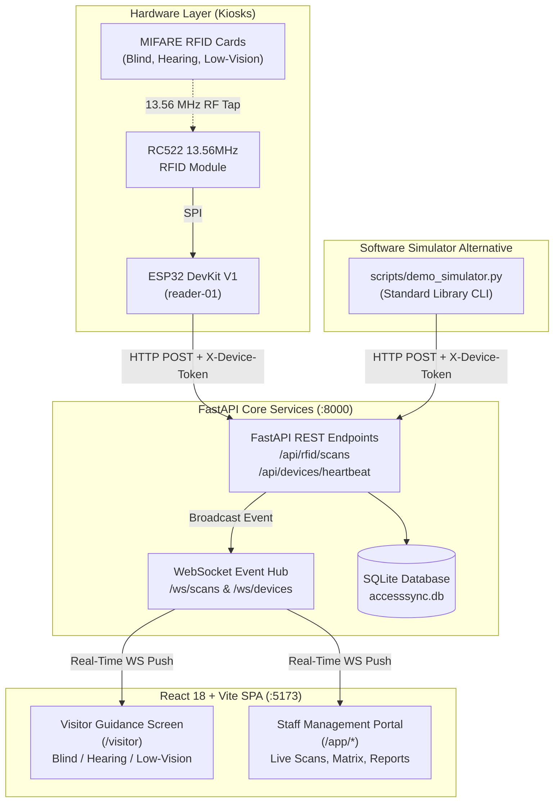

# ACCESS-EASE Live Demonstration & Systems Integration Guide
## Grand Plaza Mall Accessibility Guidance Platform

**Phase 11: Systems Integration & Live Presentation**  
**Repository:** `c:/Users/rkrsa/OneDrive/Desktop/accesssync`  
**Target Environment:** Grand Plaza Mall Physical & Virtual Kiosks  

---

## 1. System Architecture Overview



---

## 2. Environment Setup & Prerequisites

Before starting the live demonstration, ensure both the backend server and frontend development client are running.

### Step 1: Start the Backend Service
Open Terminal 1:
```powershell
cd c:\Users\rkrsa\OneDrive\Desktop\accesssync
$env:PYTHONPATH="backend"
python -m uvicorn app.main:app --host 0.0.0.0 --port 8000 --reload
```
- **REST API Base:** `http://localhost:8000`
- **Swagger Documentation:** `http://localhost:8000/docs`
- **Healthcheck:** `http://localhost:8000/api/health`

### Step 2: Start the Frontend Portal
Open Terminal 2:
```powershell
cd c:\Users\rkrsa\OneDrive\Desktop\accesssync\frontend
npm run dev
```
- **Visitor Guidance Screen:** `http://localhost:5173/visitor`
- **Staff Portal Sign In:** `http://localhost:5173/login`
- **Accessibility Conformance:** `http://localhost:5173/accessibility`

### Default Staff Credentials:
- **Username:** `admin`
- **Password:** `ChangeMe123!` (or your updated password)

---

## 3. Demo Scenario 1: Visitor Guidance Modes (Blind, Hearing, Low-Vision)

**Objective:** Showcase personalized, barrier-free multi-modal guidance activated instantaneously upon tapping an accessibility card.

### Preparation:
1. Open a browser window to `http://localhost:5173/visitor`.
2. The screen displays the clean, high-contrast idle state:
   *"Tap your accessibility card on the reader."*

### Execution:
Open Terminal 3 to simulate physical RFID card taps using `scripts/demo_simulator.py` (or tap physical cards on an attached ESP32 reader):

#### A. Blind Mode Demonstration (Card `AAAAAAAA`):
```bash
python scripts/demo_simulator.py --mode scan --uid AAAAAAAA
```
- **Visual & Auditory Feedback:**
  - Screen transitions into **Blind Mode** with high-contrast teal theme.
  - Exactly one `<h1>` header reading *"Main Entrance (Grand Plaza Mall)"*.
  - Step-by-step sequential guidance cards.
  - Audible speech synthesis: click **"Read Aloud"** to hear spoken navigation instructions.
  - Obstacle alert boxes with `role="alert"` prominently identify steps or escalators.
  - Automatically resets to idle after 60 seconds (or click *"Tap New Card"*).

#### B. Hearing Mode Demonstration (Card `BBBBBBBB`):
```bash
python scripts/demo_simulator.py --mode scan --uid BBBBBBBB
```
- **Visual Feedback:**
  - Screen transitions into **Hearing Mode** (amber/gold theme).
  - High-visibility visual emergency alerts and green illuminated exit paths.
  - Directional icons, elevator floor directories, and seating guidance without auditory reliance.

#### C. Low-Vision Mode Demonstration (Card `CCCCCCCC`):
```bash
python scripts/demo_simulator.py --mode scan --uid CCCCCCCC
```
- **Visual Feedback:**
  - Screen transitions into **Low-Vision Mode**.
  - Typography scales to 24px+ by default.
  - Switch font size between **100%**, **150%**, and **200%**.
  - Toggle color contrast themes: **Default**, **High-Contrast (White on Black)**, and **Yellow on Black**.

#### D. Unregistered Card Rejection (Card `99999999`):
```bash
python scripts/demo_simulator.py --mode scan --uid 99999999
```
- **Feedback:**
  - Neutral alert: *"Card not recognized. Please try again or ask staff for help."*
  - No private data exposed.
  - Resets automatically after 10 seconds.

---

## 4. Demo Scenario 2: Real-Time Staff Live Scans Monitoring

**Objective:** Demonstrate real-time WebSocket event ingestion on the staff operations dashboard.

1. In a separate browser tab, navigate to `http://localhost:5173/login` and sign in.
2. Open the **Live Scans** page at `http://localhost:5173/app/scans`.
3. Note the green **"WebSocket Live"** badge.
4. Run the automated sequence in Terminal 3:
   ```bash
   python scripts/demo_simulator.py --mode sequence --interval 2.5
   ```
5. **Observation:**
   - As each card is tapped in the terminal, a new record animates into the top of the feed with reverse-chronological ordering.
   - Status badges display green for `Accepted` and red for `Rejected` with exact reason codes.
   - Filter the live feed by Result (*Accepted / Rejected*), Time Range (*Last hour / 24h*), or Device (*reader-01*).

---

## 5. Demo Scenario 3: Accessibility Criteria Assessment & Score Indicator

**Objective:** Demonstrate internal facility evaluation, floor filtering, and compliant indicator calculation.

1. Navigate to `http://localhost:5173/app/assessments`.
2. **Observation:**
   - The circular indicator displays the compliance percentage (e.g., **63%** or **50%**) with the mandatory disclaimer:
     *"Internal assessment indicator, not a certified accessibility rating."*
   - Breakdown counters clearly state: **Pass**, **Needs Improvement**, **Fail**, and **Not Assessed**.
   - Floor sections (Ground Floor, Floor 1, Floor 2) organize mall areas.
3. Click any matrix cell to open the accessible **Evaluation Dialog**.
4. Change a criterion from *"Needs Improvement"* to *"Pass"*, enter inspection notes, and save.
5. The circular indicator and breakdown immediately recompute without a full page reload.

---

## 6. Demo Scenario 4: Exporting CSV Reports & Printing Compliance PDF

**Objective:** Show operational compliance reporting, historical summaries, and print stylesheets.

1. Navigate to `http://localhost:5173/app/reports`.
2. **Section 1 (Scan Activity):** Filter date ranges and click **"Export CSV"** to download `scan_activity_report.csv`.
3. **Section 2 (Accessibility Assessment):** Review criteria breakdown across all zones and export `accessibility_assessment_report.csv`.
4. **Section 3 (Card Usage):** Identify most-used cards versus inactive cards and export `card_usage_report.csv`.
5. **Section 4 (Device Telemetry):** Review connected reader health and scan volume.
6. Click **"Print Report"**:
   - The browser print preview triggers.
   - Print stylesheet automatically hides navigation bars, filters, and action buttons, producing a clean multi-page document with mall headers and page breaks.

---

## 7. Demo Scenario 5: Hardware Heartbeat Telemetry & Reader Status

**Objective:** Demonstrate device connectivity monitoring and automatic offline timeout.

1. On any staff portal page (`/app/dashboard`, `/app/scans`, `/app/reports`), inspect the top navigation bar.
2. The reader badge shows **"Reader: Online"** (green indicator).
3. Send a manual heartbeat via the simulator:
   ```bash
   python scripts/demo_simulator.py --mode heartbeat
   ```
   - Terminal prints HTTP 200 with latency.
   - On physical hardware, the status LED performs a quick double-blink.
4. *Stress Test:* Run 20 rapid scans to confirm server resilience and idempotency handling:
   ```bash
   python scripts/demo_simulator.py --mode stress
   ```

---

## 8. Live Presentation Fallback & Troubleshooting

| Issue Encountered | Presentation Workaround / Fallback |
| :--- | :--- |
| **Physical ESP32 loses Wi-Fi connection** | Immediately switch to `scripts/demo_simulator.py --mode sequence` to continue the demonstration seamlessly without interruption. |
| **WebSocket disconnects (Yellow badge)** | The frontend automatically degrades to 5-second HTTP polling. All scans and live feed updates continue normally. |
| **Speaker audio unavailable for Blind Mode** | Blind Mode provides high-contrast visual transcripts for every step alongside speech controls. Show the text cards and live region inspection. |
| **Port 8000 already in use** | Run `$env:PYTHONPATH="backend"; python -m uvicorn app.main:app --host 0.0.0.0 --port 8001` and pass `--url http://localhost:8001` to the simulator. |
